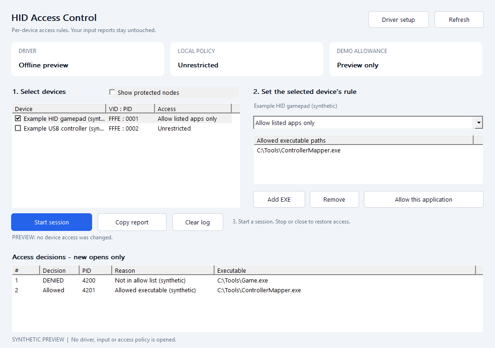

# HID Access Control - Windows HID Device Access Filter Driver and C++ SDK

Choose which applications can open compatible controllers, with per-device rules, a small C++ SDK and a native Windows interface. Use it to give a remapper access to a physical controller while other applications use its virtual output, or to test application/device routing.

> [!IMPORTANT]
> **Full driver version without demo restrictions: Discord `titancsa`.**
> Open Discord, choose **Friends > Add Friend**, enter **`titancsa`**, then message me with **HID Access Control** for commercial availability, pricing and license instructions.

**[Download the signed demo](https://github.com/titanfyre/HID-Access-Control/releases/latest)** | [SDK](SDK/README.md) | [Example](Examples/access.cpp) | [Installation](docs/INSTALLATION.md) | [Validation](docs/VALIDATION.md)

> **Microsoft-signed driver included.** The self-contained UI and console installers embed the matching filter and boot-clock package. Administrator rights and a Windows restart may be required. Test mode is not required. Setup verifies catalog trust and package membership before installation.



## What it does

- **Allow listed applications:** selected programs can open the chosen device; other user-mode callers are refused.
- **Deny listed applications:** selected programs are refused; other callers retain access.
- **Block all user-mode applications:** refuse new user-mode opens of the chosen device.
- Set a different mode and executable list for each selected device; replace the entire policy atomically.
- Read an access log containing the requesting process, application path, device and matched decision reason. Copy a diagnostic report from the UI.
- Stop hiding immediately, or close the owning application to restore ordinary access automatically.

Policies concern **new device opens**. Existing handles keep their access until closed. The filter does not remove PnP nodes, change device identity or edit input reports. It adds no policy work to each report. Kernel-mode opens remain transparent. Applications that share a Windows broker are seen as that broker; this is not a per-web-tab permission system or a security boundary against administrators/kernel code.

The first version targets **Windows 10 2004+ / Windows 11 x64**. HID gamepad/joystick collections are classified from their generic Windows usage identities, with no model-specific VID/PID list. XUSB and GIP class paths are included in the filter architecture; their physical transport/app compatibility must be qualified separately. Keyboard, mouse, unclassified HID collections and HID transport parents are protected from policy selection in the kernel. A single physical controller may expose several Windows nodes.

## Use the interface

1. Download and extract the complete release ZIP, or download a standalone setup EXE from the same release.
2. Run `HidAccessSetup.exe` and choose **Install / reinstall**. Use Windows **Restart** when requested, so Windows rebuilds existing device stacks.
3. Open `HidAccessApp.exe` as administrator. Refresh the device list and select the controller collection you want to manage.
4. Choose its access mode and add the executable files concerned. For example, allow your remapper's EXE for the physical controller and let games open the separate virtual controller.
5. Start the session. Changes to an active policy take effect for subsequent device opens. Close and reopen the receiving program if it already owns a handle.
6. Use **Stop** to restore access. Closing the UI also clears its session policy. Use **Copy report** to inspect installation, devices and access decisions.

The UI is an example of the same public SDK; there is no separate application-only hiding mechanism. One application owns configuration at a time. An access denial in the log identifies this filter's decision; an allowed open may still fail later in another driver or in the receiving application. `HidAccessApp.exe --preview` provides a labelled synthetic tour without opening a driver session.

## Minimal C++ integration

Add `SDK/HidAccess.cpp`, `SDK/HidAccess.h` and `Protocol/HidAccessProtocol.h` to a C++17 Windows x64 project. Link `advapi32.lib`. Failures throw `std::system_error` with a stage and Windows error code.

```cpp
#include "HidAccess.h"
#include <algorithm>
#include <iostream>

int main() try {
    HidAccess::Session access;
    const auto devices = access.Devices();
    const auto pad = std::find_if(devices.begin(), devices.end(),
        [](const auto& d) { return d.supported; });
    if (pad == devices.end()) return 1;

    access.Apply({{pad->token, HidAccess::Mode::AllowListed,
                   {L"C:\\Tools\\MyRemapper.exe"}}});
    std::cout << "Policy active. Press Enter to restore access.\n";
    std::cin.get();
} catch (const std::exception& error) {
    std::cerr << error.what() << '\n';
    return 1;
}
```

Choose the intended device explicitly in a real application; the short example uses the first supported controller. The selected executable must exist. Tokens identify a current device attachment and are obtained again after reconnecting/restarting. The SDK resolves Windows paths to native image paths and infers rule counts and application masks. See [the runnable example](Examples/access.cpp) and [SDK reference](SDK/README.md).

| Function | Purpose |
| --- | --- |
| `HidAccess::Probe()` | Read installation/service state without activating a policy |
| `Session::Devices()` | List attached filter nodes, tokens and protection flags |
| `Session::Apply(rules)` | Validate and atomically replace this session's rules |
| `Session::GetStatus()` | Read activity, demo allowance, counters and generation |
| `Session::ReadEvents()` | Drain a bounded batch of access decisions |
| `Session::Stop()` | Clear the policy; an empty `Apply` also stops it |
| Session destructor | Close ownership and restore access, including after exceptions |

## Demo and installation

The demo allows **one hour per Windows kernel boot**, starting with the first successful active policy. Time continues while hiding is stopped or the application is closed. At expiry policies are disabled and subsequent device opens pass through. Use Windows **Restart** for a new allowance; closing, reinstalling and reopening applications does not renew it.

The Microsoft-signed driver package contains the access filter and a small resident boot-clock driver, `TitanHidAccess.sys` and `TitanHidAccessClock.sys`. The clock is started on first activation and stays resident until restart. No user-mode background service or online account is needed for this demo. [Setup and clean removal](docs/INSTALLATION.md).

## Build and source

Demo/evaluation driver source is available; see [driver/README.md](driver/README.md) for
build instructions and separate evaluation-source terms. Those terms apply to
Titan-authored driver code. Third-party source licenses and existing application/SDK
licenses remain applicable. Full/commercial implementation and private signing or
activation material are excluded.

Run `./Build.ps1 -Test` with Visual Studio 2022 C++ tools, CMake and a Windows SDK. It embeds the supplied signed binaries from `Installer/Driver` into both setup EXEs. `-Asan -Test` enables user-mode memory checks. `-DriverPackageDirectory` selects another matching opaque signed package; runtime setup still verifies its trust and catalog membership. Building never installs a driver or enables a live policy automatically.

```text
App/          Native UI example and labelled offline preview
SDK/          HidAccess.h + HidAccess.cpp and API notes
Protocol/     Bounded public wire ABI
Examples/     Small independent C++ example
Installer/    UI/console setup source and opaque signed driver package
Tests/        Offline protocol and bounds validation
docs/         Installation, validation and interface image
licenses/     Separate driver evaluation terms
```

The public user-mode source is [MIT licensed](LICENSE); **Demo/evaluation driver source is documented in [driver/README.md](driver/README.md)**. The opaque signed driver files have [separate demo terms](licenses/BINARY-LICENSE.txt). This independent project addresses the input-device access-control use case popularized by [Nefarius HidHide](https://github.com/nefarius/HidHide), with its own SDK, session ownership and per-device policy model. It is not affiliated with Nefarius and does not implement HidHide's binary/API contract. Live behavior and compatibility are documented in [validation](docs/VALIDATION.md).

Use only on systems you own or are authorized to administer. The software is supplied as-is under its applicable license. Users remain responsible for lawful use and applicable third-party rules; no guarantee of universal compatibility, security isolation or absence of defects is made.

<!-- central-sdk-packages:start -->
## SDK : langages et installation

Les sources, licences, guides API et exemples des SDK sont regroupes dans [le depot dedie](https://github.com/TitanCSA/sdk-packages/tree/main/projects/HID-Access-Control). Choisis ton langage ci-dessous, puis execute sa commande dans le dossier de ton application.

| Langage / registre | Disponibilite | Installation / utilisation |
| --- | --- | --- |
| C++ / vcpkg | Registre TitanCSA disponible (configuration ci-dessous) | `vcpkg install hid-access-control:x64-windows` |
| C++ / Conan | Registre TitanCSA disponible (configuration ci-dessous) | `conan install --requires=hid-access-control/0.1.0 -r titancsa --build=missing -s compiler.cppstd=17` |
| C++ / NuGet natif | Publie et verifie | `Install-Package HID-Access-Control.Native -Version 0.1.0` |
| C# / .NET | Publie et verifie | `dotnet add package HIDAccessControl.SDK --version 1.0.0` |
| Python / pip | Pas encore disponible / validation en cours | Commande prevue apres publication : `python -m pip install hid-access-control==1.0.0` |
| Python / Conda | Canal TitanCSA disponible ; acceptation conda-forge encore en attente | `conda install --override-channels -c https://raw.githubusercontent.com/TitanCSA/sdk-packages/089bc73095aa8eda89bacbe10d0b9e58394b0207/conda-channel -c conda-forge hid-access-control` |
| Rust / Cargo | Publie et verifie | `cargo add hid-access-control@1.0.0` |
| JavaScript et TypeScript / npm | Pas encore disponible / validation en cours | Commande prevue apres publication : `npm install hid-access-control@1.0.0` |
| Java et Kotlin / Maven Central | Publie et verifie | `io.github.titancsa:hid-access-control:1.0.0 (pom.xml / Gradle)` |
| Java et Kotlin / JitPack | Publie et verifie | `com.github.titanfyre:HID-Access-Control:java-sdk-v1.0.0 (avec le depot JitPack)` |
| Go / Go Modules | Publie et verifie | `go get github.com/titanfyre/HID-Access-Control/HID-Access-Control-Go-modules@v1.0.0` |
| Go / pkg.go.dev | Publie et verifie | `Documentation : https://pkg.go.dev/github.com/titanfyre/HID-Access-Control/HID-Access-Control-Go-modules@v1.0.0` |
| PowerShell / Gallery | Publie et verifie | `Install-Module HIDAccessControl -RequiredVersion 1.0.0 -Scope CurrentUser` |
| Dart et Flutter / pub.dev | Pas encore disponible / validation en cours | Commande prevue apres publication : `dart pub add hid_access_control:1.0.0` |
| Ruby / RubyGems | Publie et verifie | `gem install hid-access-control -v 1.0.0` |
| PHP / Composer | Pas encore disponible / validation en cours | Commande prevue apres publication : `composer require titancsa/hid-access-control:1.0.0` |

Pour vcpkg et Conan, configure d abord le registre TitanCSA avec [ces instructions](https://github.com/TitanCSA/sdk-packages/tree/main/projects/HID-Access-Control/README.md#c-et-c). Pour Java/Kotlin, le guide donne le bloc Maven/Gradle a ajouter. Windows x64 est requis pour les bindings natifs ; les pilotes/applications restent a installer separement.

Les commandes indiquees comme prevues ne sont pas encore disponibles. Les versions Go/JitPack existantes utilisent les anciens tags conserves ; aucun ancien import Go n est renomme.

[Guide complet, prerequis et exemples](https://github.com/TitanCSA/sdk-packages/tree/main/projects/HID-Access-Control/README.md).
<!-- central-sdk-packages:end -->
